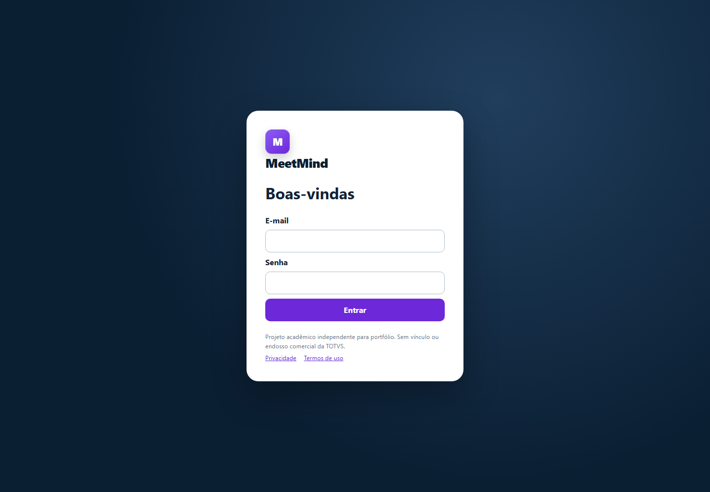

# MeetMind

Painel auditável de Customer Success que transforma reuniões em evidências, planos e
ações sem inventar o que o cliente não disse.

```text
Reunião → evidência literal → plano → ação → encaminhamento ou follow-up
```

O MeetMind nasceu em um desafio acadêmico FIAP/TOTVS e foi evoluído como projeto de
portfólio independente. A especialização de IA demonstrada é de Manufatura; outros setores
dependem de playbooks e validações próprias antes de serem habilitados.

> Este não é um produto oficial nem um canal operacional da TOTVS. Consulte
> [NOTICE.md](NOTICE.md).



## O que o projeto demonstra

- ingestão, normalização e deduplicação de transcrições;
- análise estruturada com citações literais e incerteza explícita;
- trilha de evidência até plano, ação e encaminhamento;
- dashboard diário por carteira, equipe e papel;
- entregas do gestor para a equipe com prazo, acompanhamento e calendário;
- visão individual de reuniões, carteira, pendências e encaminhamentos do analista;
- visão 360º do cliente e contatos;
- rascunhos de comunicação com aprovação humana;
- OAuth para Google Calendar e Microsoft 365 no ambiente completo;
- isolamento por organização, controle de acesso e auditoria;
- filas assíncronas, antivírus e armazenamento externo preparados para operação.

## Vitrine pública

A publicação de portfólio usa somente dados sintéticos e é somente leitura. Uploads,
alterações e funções administrativas ficam desativados para evitar abuso. Calendários
permanecem bloqueados nas contas públicas; uma dupla privada de gestor e analista,
criada por segredos do ambiente, valida atribuição e OAuth real sem compartilhar a
agenda com visitantes.

```powershell
Copy-Item .env.example .env
# defina SECRET_KEY e, opcionalmente, DEMO_PORTFOLIO_PASSWORD no .env
docker compose up --build -d
docker compose exec web flask --app run.py seed-demo
```

Abra `http://localhost:8000`. Para testar a jornada principal, use
`ana@meetmind.example` e a senha mostrada pelo comando. O seed é idempotente e a
organização `meetmind-demo` recebe identificação visual permanente.

## Arquitetura

```text
Jinja + JavaScript nativo
          │
     Flask / Gunicorn
       │          │
 PostgreSQL    Redis / RQ
                  │
          workers especializados
                  │
         provedor de IA configurado
```

A aplicação separa o processo web, migrações e workers. Somente workers recebem
credenciais de IA no ambiente completo. O navegador usa rotas relativas em `/api/v1`,
CSRF, cookies protegidos e uma CSP restritiva.

## Qualidade

```powershell
python -m ruff check app tests tools config.py
python -m pytest
python tools/evaluate_ai_quality.py evaluations/gold.sample.jsonl --validate-only
```

O CI também valida migrações em SQLite e PostgreSQL, isolamento por RLS, JavaScript,
dependências, imagem Docker, SBOM e CodeQL.

## Deploy

O repositório inclui um Blueprint do Render com serviço Docker, PostgreSQL, migração e
seed sintético:

- [DEPLOY.md](DEPLOY.md): publicação e checklist pós-deploy;
- [.env.portfolio.example](.env.portfolio.example): contrato mínimo de ambiente;
- [render.yaml](render.yaml): infraestrutura reproduzível;
- [docs/ENTERPRISE_READINESS.md](docs/ENTERPRISE_READINESS.md): requisitos para operação;
- [docs/DATA_GOVERNANCE.md](docs/DATA_GOVERNANCE.md): limites de dados e LGPD;
- [docs/RIPD_TEMPLATE.md](docs/RIPD_TEMPLATE.md): avaliação técnica de privacidade.

## Limites

- O repositório público não inclui reuniões reais, dumps, planilhas de avaliação, chaves,
  tokens ou capturas com dados pessoais.
- Os resultados exibidos na vitrine foram gerados como dados sintéticos.
- A análise de IA não substitui decisão humana nem prevê churn ou venda.
- Integrações externas exigem credenciais próprias e uma política de privacidade adequada.

Licença: todos os direitos reservados para avaliação de portfólio; veja [LICENSE](LICENSE).
